<p align="center">
  
</p>

<p align="center">
  <a href="https://github.com/ishandutta2007/Awesome-Awesome-Awesome"></a>
  <a href="https://discord.gg/jc4xtF58Ve"></a>
  <a href="https://github.com/ishandutta2007/Awesome-Youtube-Community-Platforms/stargazers"></a>
  <a href="https://github.com/ishandutta2007/Awesome-Youtube-Community-Platforms/network/members"></a>
  <a href="https://github.com/ishandutta2007/Awesome-Youtube-Community-Platforms/blob/main/LICENSE"></a>
  <a href="https://github.com/ishandutta2007/Awesome-Youtube-Community-Platforms/pulls"></a>
  <a href="https://github.com/ishandutta2007"></a>
</p>

---

# 🚀 Awesome YouTube Community Platforms

> **A curated, comprehensive directory of leading SaaS platforms and self-hosted open-source software enabling YouTube creators to build, engage, monetize, and own their community outside the YouTube comment section.**

YouTube creators often discover that the default YouTube comments and Community tab restrict deep fan relationships, real-time interactivity, and diversified monetization. Building a dedicated community hub unlocks private discussion boards, real-time voice and text chat, structured online courses, exclusive subscriber perks, and complete audience data sovereignty.

---

## 📑 Table of Contents

- [🌐 Sector Overview & Market Dynamics](#-sector-overview--market-dynamics)
- [🏢 SaaS & Hosted Community Platforms](#-saas--hosted-community-platforms)
- [💻 Open-Source & Self-Hosted GitHub Projects](#-open-source--self-hosted-github-projects)
- [🧩 Community Architectural Archetypes](#-community-architectural-archetypes)
- [💡 Frequently Asked Questions (FAQ)](#-frequently-asked-questions-faq)
- [🤝 How to Contribute](#-how-to-contribute)
- [⭐ Star History](#-star-history)
- [💖 Support & Community](#-support--community)
- [📜 License & Disclaimer](#-license--disclaimer)

---

## 🌐 Sector Overview & Market Dynamics

The global online community platforms and creator software market is estimated at **$5.8 billion in 2024–2026** and is projected to expand to **$11.4 billion by 2030**, growing at a compound annual growth rate (**CAGR**) of **~15.2%**. This surge is propelled by creators de-risking their businesses from social algorithm volatility, seeking recurring fan revenue, and reclaiming direct member relationships.

The sector exhibits **moderate fragmentation with multi-polar concentration**:
- **Horizontal Real-Time Giants (Concentrated Layer)**: Multi-billion dollar platforms like **Telegram** and **Discord** dominate top-of-funnel fan chat, gaming hangouts, and real-time broadcasts through massive network effects.
- **Vertical Creator Ecosystems (Segmented Growth Layer)**: Purpose-built platforms like **Circle.so**, **Skool**, **Mighty Networks**, and **Whop** capture high-ARPU creators through packaged gamification, paid courses, and built-in membership checkouts.
- **Decentralized & Open-Source Software (Sovereignty Layer)**: Production-grade self-hosted tools (**Discourse**, **Flarum**, **NodeBB**, **Lemmy**, **PeerTube**, **Matrix**) maintain an expanding footprint among developers, educators, and creators who prioritize strict data privacy, custom workflows, and zero platform rake.

---

## 🏢 SaaS & Hosted Community Platforms

The table below catalogs premier commercial SaaS solutions for YouTube creators. Entries are **sorted in descending order of company size (valuation / estimated market capitalization / revenue)**.

| 🏷️ Platform | 📊 Company Scale (Valuation / Revenue) | 💳 Starting Tier Pricing | 🎁 Free Tier / Trial Limits | 🎯 Primary Focus & Features |
| :--- | :--- | :--- | :--- | :--- |
| **[Telegram](https://telegram.org/)** ✈️ | **~$30.0B Valuation**<br>~$342M+ Revenue (950M+ MAU) | **Free core app**<br>Telegram Premium: **$4.99/mo** (or $3.99/mo annual) | **Free Forever**<br>Unlimited channel subscribers, up to 200,000 members per supergroup, 2GB upload limit per file | Broadcast channels, live audio stages, subscriber groups, automated bots, and instant content delivery. |
| **[Discord](https://discord.com/)** 🎮 | **~$15.0B Valuation**<br>~$600M+ Annual Revenue | **Free core platform**<br>Nitro Basic: **$2.99/mo**<br>Server Boost L1: **$9.98/mo** (2 boosts) | **Free Forever**<br>Up to 500,000 server members, unlimited voice/text channels, 25-person video stream limit, 10MB upload limit | Real-time voice lounges, structured topic channels, stages, role automation, bot ecosystem, and gamer communities. |
| **[Whop](https://whop.com/)** 🛍️ | **~$500M+ Valuation**<br>$1B+ Cumulative GMV ($17M+ raised) | **Free setup**<br>**3% platform fee** + payment processing (2.7% + $0.30) | **Free Forever**<br>Unlimited members, courses, digital downloads, forums, and chat rooms; pay only 3% transaction fee on sales | Creator marketplace, gated content access, Discord role integration, software licenses, and fan monetization. |
| **[Mighty Networks](https://www.mightynetworks.com/)** 🔮 | **~$250M Valuation**<br>~$25M+ ARR ($67M funding) | **$41/mo** (billed annually at $492/yr) or $49/mo monthly (+ 3% transaction fee) | **14-day free trial**<br>Full access to Business plan, unlimited members, unlimited spaces, native video, no CC required | Branded community activity feeds, cohort courses, native events, livestreaming, and member subscriptions. |
| **[Hivebrite](https://hivebrite.com/)** 🏛️ | **~$180M Valuation**<br>~$20M ARR ($57M funding) | **$7,900/year** (Connect plan, ~$658/mo billed annually) up to 1,000 members | **14-day free trial**<br>Available via requested demo in sandboxed staging environment; no permanent free tier | Enterprise creator networks, university alumni directories, high-end professional associations, and tiered access. |
| **[Circle.so](https://circle.so/)** ⭕ | **~$120M Valuation**<br>~$20M+ ARR ($30M funding) | **$89/mo** (billed annually at $1,068/yr) or $99/mo monthly (+ 2% transaction fee) | **14-day free trial**<br>Full access to Professional tier, up to 100 test members, live streaming, no CC required | All-in-one creator spaces, modular community feeds, structured course builder, live broadcasts, and automations. |
| **[Skool](https://skool.com/)** 🎒 | **~$100M+ Valuation**<br>~$30M+ ARR (Alex Hormozi backed) | **$99/mo flat fee** per community (+ 2.9% + 30¢ Stripe processing fee) | **14-day free trial**<br>1 active group, unlimited members, unlimited courses, gamified leaderboards, CC required | Gamified learning communities, student leaderboards, course modules, calendar events, and streamlined feed. |
| **[Discourse (Hosted)](https://www.discourse.org/)** 💬 | **~$80M Est. Valuation**<br>~$12M+ ARR (Profitable / bootstrapped) | **$20/mo** (Basic plan billed annually at $240/yr) or $25/mo monthly | **14-day free trial**<br>Managed cloud hosting, up to 100k monthly pageviews, full plugins, no CC required | Deep searchable forum discussions, trust-level community moderation, mailing list mode, and developer integrations. |
| **[Geneva](https://geneva.com/)** 🏡 | **~$60M Valuation**<br>$20M+ Raised (Benchmark Capital) | **Free core platform**<br>5% fee on paid member passes & ticketed events | **Free Forever**<br>Unlimited rooms, unlimited members, up to 50 speakers on audio/video stages, 0 subscription fee | Casual clubs, creator group chats, audio hangouts, video stages, curated announcements, and event calendars. |
| **[Bettermode](https://bettermode.com/)** 🧩 | **~$50M Valuation**<br>~$8M ARR ($10.5M funding) | **$19/mo** (Starter plan billed annually at $228/yr) or $24/mo monthly | **14-day free trial**<br>Unlimited spaces, customizable layout blocks, moderation workflows, no CC required | Embeddable community portals, customer feedback boards, creator knowledge bases, and modular design. |
| **[Heartbeat.chat](https://heartbeat.chat/)** 💓 | **~$25M Valuation**<br>Seed-funded ($3M+ raised, YC S21) | **$40/mo** (Starter plan billed annually at $480/yr) or $49/mo monthly (0% fee) | **14-day free trial**<br>Up to 1,000 members, unlimited channels, voice rooms, docs, events, no CC required | Unified creator hub combining chat threads, voice rooms, live event scheduling, docs, and course hosting. |

---

## 💻 Open-Source & Self-Hosted GitHub Projects

Take full control of your member data, eliminate third-party platform cuts, and self-host your YouTube community infrastructure. Projects are **strictly sorted in descending order of GitHub stargazers**.

1. **[Mastodon](https://github.com/mastodon/mastodon)** [](https://github.com/mastodon/mastodon/stargazers)  
   *Decentralized, federated microblogging and social networking platform powered by ActivityPub.*  
   Allows YouTube creators to deploy an independent social network where followers can engage with posts, polls, and media from Mastodon or any fediverse server without algorithmic throttling.  
   `Ruby on Rails` • `React` • `ActivityPub` • `AGPL-3.0`

2. **[Discourse](https://github.com/discourse/discourse)** [](https://github.com/discourse/discourse/stargazers)  
   *The gold-standard modern discussion platform for civilized community conversations.*  
   Features 200+ battle-tested plugins, automated trust levels, AI-assisted moderation, SSO integration (OAuth/SAML), real-time chat channels, and ActivityPub federation.  
   `Ruby on Rails` • `Ember.js` • `PostgreSQL` • `Redis` • `GPL-2.0`

3. **[Rocket.Chat](https://github.com/RocketChat/Rocket.Chat)** [](https://github.com/RocketChat/Rocket.Chat/stargazers)  
   *The open-source communications OS for team and community collaboration.*  
   Real-time chat, video conferencing, audio channels, omnichannel community engagement, granular role-based permissions, and end-to-end encryption.  
   `TypeScript` • `Node.js` • `MongoDB` • `MIT`

4. **[Mattermost](https://github.com/mattermost/mattermost)** [](https://github.com/mattermost/mattermost/stargazers)  
   *High-performance self-hosted collaboration and real-time community messaging platform.*  
   Delivers organized channels, voice huddles, workflow boards, interactive bot integrations, and complete compliance controls with self-hosted hosting.  
   `Go` • `React` • `PostgreSQL` • `MySQL` • `AGPL-3.0`

5. **[Zulip](https://github.com/zulip/zulip)** [](https://github.com/zulip/zulip/stargazers)  
   *Powerful open-source team chat that uniquely blends real-time chat with email-style threading.*  
   Solves the chaos of high-velocity creator chat rooms by enforcing topic threads, ensuring long-tail conversations never get buried in continuous scrolling.  
   `Python` • `Django` • `TypeScript` • `PostgreSQL` • `Apache-2.0`

6. **[Forem](https://github.com/forem/forem)** [](https://github.com/forem/forem/stargazers)  
   *Open-source community software engineered to power independent, passionate networks.*  
   The battle-tested engine driving DEV.to and CodeNewbie. Features long-form rich articles, podcast feeds, community discussions, badges, listings, and member profiles.  
   `Ruby on Rails` • `Preact` • `PostgreSQL` • `Redis` • `AGPL-3.0`

7. **[PeerTube](https://github.com/Chocobozzz/PeerTube)** [](https://github.com/Chocobozzz/PeerTube/stargazers)  
   *Federated, decentralized video hosting, live streaming, and creator community platform.*  
   Powered by ActivityPub and WebTorrent P2P bandwidth distribution. Provides creators with sovereign video channels, comment threads, playlists, and cross-instance federation.  
   `TypeScript` • `Node.js` • `Angular` • `PostgreSQL` • `AGPL-3.0`

8. **[NodeBB](https://github.com/NodeBB/NodeBB)** [](https://github.com/NodeBB/NodeBB/stargazers)  
   *Next-generation forum software built on Node.js with instant WebSocket push updates.*  
   Responsive mobile-first layout, rich notification system, RESTful API endpoints, theme manager, and native ActivityPub federation support.  
   `Node.js` • `Redis` • `MongoDB` • `PostgreSQL` • `GPL-3.0`

9. **[Lemmy](https://github.com/LemmyNet/lemmy)** [](https://github.com/LemmyNet/lemmy/stargazers)  
   *A link aggregator and discussion platform for the fediverse, written in Rust.*  
   Self-hostable Reddit alternative where creators host community sub-boards that federate across thousands of fediverse servers.  
   `Rust` • `Actix` • `Diesel` • `PostgreSQL` • `AGPL-3.0`

10. **[Element Web / Matrix](https://github.com/element-hq/element-web)** [](https://github.com/element-hq/element-web/stargazers)  
    *Glossy, modern web client for Matrix — the open standard for decentralized communication.*  
    End-to-end encrypted messaging, voice/video group rooms, and bridges to Discord, Slack, and Telegram for unified community moderation.  
    `TypeScript` • `React` • `Matrix Protocol` • `Apache-2.0`

11. **[Owncast](https://github.com/owncast/owncast)** [](https://github.com/owncast/owncast/stargazers)  
    *Take control over your live stream video by running it yourself — single binary stream + chat.*  
    Independent YouTube Live and Twitch alternative providing sub-second low-latency video streaming, interactive live chat, custom emotes, tipping links, and Fediverse notifications.  
    `Go` • `WebSockets` • `HLS` • `MIT`

12. **[Misskey](https://github.com/misskey-dev/misskey)** [](https://github.com/misskey-dev/misskey/stargazers)  
    *Interplanetary decentralized microblogging and multimedia community platform.*  
    Rich customizable interface, animated custom emoji reactions, drive file manager, channels, clip creation, and timeline streaming via ActivityPub.  
    `TypeScript` • `Vue 3` • `PostgreSQL` • `Redis` • `AGPL-3.0`

13. **[Flarum](https://github.com/flarum/framework)** [](https://github.com/flarum/framework/stargazers)  
    *Delightfully simple, blazing-fast discussion forum software with modular architecture.*  
    Minimalist two-pane discussion navigation, instant search, lightweight mobile layout, and a rich ecosystem of community extensions.  
    `PHP` • `Mithril.js` • `MySQL` • `MIT`

14. **[WriteFreely](https://github.com/writefreely/writefreely)** [](https://github.com/writefreely/writefreely/stargazers)  
    *Clean, distraction-free Markdown publishing platform built for community writing.*  
    Allows creators to publish long-form newsletters, tutorials, and community publications connected to the fediverse via ActivityPub.  
    `Go` • `Markdown` • `SQLite` • `MySQL` • `AGPL-3.0`

15. **[Bonfire](https://github.com/bonfire-networks/bonfire-app)** [](https://github.com/bonfire-networks/bonfire-app/stargazers)  
    *Modular, federated community platform for coordinating discussions, groups, and actions.*  
    Enables creators to establish circles, collaborative decision boards, and private feeds that federate securely across the ActivityPub network.  
    `Elixir` • `Phoenix` • `LiveView` • `AGPL-3.0`

16. **[Valour](https://github.com/Valour-Software/Valour)** [](https://github.com/Valour-Software/Valour/stargazers)  
    *Next-generation community platform organizing spaces into interactive "planets".*  
    Features real-time chat channels, threaded forum feeds, internal wikis, integrated voice/video calling, and member virtual hubs.  
    `C#` • `.NET` • `Blazor` • `PostgreSQL` • `AGPL-3.0`

17. **[Storyden](https://github.com/southclaws/storyden)** [](https://github.com/southclaws/storyden/stargazers)  
    *Modern forum platform fusing threaded discussions, Pinterest-style visual curation, and wikis.*  
    Prioritizes permanence, search discoverability, and automatic content tagging with full API automation.  
    `Go` • `TypeScript` • `SQLite` • `PostgreSQL` • `MPL-2.0`

18. **[Nodyx](https://github.com/Pokled/nodyx)** [](https://github.com/Pokled/nodyx/stargazers)  
    *Self-hosted all-in-one platform: Forum + Chat + Voice + P2P + Whiteboard + Homepage Builder.*  
    Runs on a single server or home Raspberry Pi behind a router with zero open ports required. One server, one community, forever.  
    `TypeScript` • `Node.js` • `WebRTC` • `AGPL-3.0`

19. **[Backspace](https://github.com/TheZwiss/backspace)** [](https://github.com/TheZwiss/backspace/stargazers)  
    *Self-hosted Discord alternative with voice, HD video, 4K/120fps screen share, and federation.*  
    Features LiveKit-powered media channels, HMAC-signed server-to-server federation, Electron desktop app, and responsive mobile PWA.  
    `TypeScript` • `LiveKit` • `WebRTC` • `AGPL-3.0`

20. **[MemberMatters](https://github.com/membermatters/MemberMatters)** [](https://github.com/membermatters/MemberMatters/stargazers)  
    *Open-source membership, subscription billing, and physical/digital access control solution.*  
    Recurring member billing via Stripe, member self-service portal, Discourse SSO provider integration, and hardware access logging.  
    `Python` • `Django` • `Vue.js` • `Stripe` • `MIT`

21. **[Lineweb Social](https://github.com/drewmt/lineweb-social)** [](https://github.com/drewmt/lineweb-social/stargazers)  
    *Self-hosted creator social platform with spaces, 24-hour stories, and member feeds.*  
    Pressure-free social networking with threaded conversations, media galleries, light/dark mode, and cohort invitation tokens.  
    `PHP` • `Laravel` • `Vue.js` • `Docker` • `MIT`

22. **[Daccord](https://github.com/DaccordProject/daccord)** [](https://github.com/DaccordProject/daccord/stargazers)  
    *Free, privacy-focused open-source chat and voice application for communities.*  
    Self-host your own Accord server daemon with native Flutter client apps across desktop and mobile, custom emoji support, and zero corporate telemetry.  
    `Dart` • `Flutter` • `Go` • `LiveKit` • `GPL-3.0`

23. **[Ashley](https://github.com/openfun/ashley)** [](https://github.com/openfun/ashley/stargazers)  
    *Self-hosted multi-tenant discussion forum framework tailored for educational learning cohorts.*  
    Designed for video course creators, cohort classes, and structured Q&A interaction across member groups.  
    `Python` • `Django` • `React` • `MIT`

24. **[Roost](https://github.com/msrbuilds/roost)** [](https://github.com/msrbuilds/roost/stargazers)  
    *Self-hosted creator community platform positioned as an open-source Skool & Circle alternative.*  
    Features integrated Stripe subscription payments, course modules with progress bars, live streaming rooms, leaderboards, and member showcases.  
    `React` • `TypeScript` • `Node.js` • `Supabase` • `MIT`

25. **[CommonPub](https://github.com/commonpub/commonpub)** [](https://github.com/commonpub/commonpub/stargazers)  
    *Open ActivityPub federation protocol suite and UI components for self-hosted maker spaces.*  
    Consists of 14 modular packages including schema, protocol auth, Meilisearch indexing, and Vue 3 frontend components.  
    `TypeScript` • `Nuxt 3` • `Vue 3` • `PostgreSQL` • `MIT`

26. **[Harmony Server](https://github.com/tartine-studio/harmony-server)** [](https://github.com/tartine-studio/harmony-server/stargazers)  
    *Zero-configuration, single-binary Discord alternative written in Go.*  
    Automatic embedded SQLite database, Pion WebRTC audio SFU, WebSocket text messaging, and zero-effort self-hosting.  
    `Go` • `WebRTC` • `SQLite` • `AGPL-3.0`

27. **[Createon](https://github.com/opd-ai/createon)** [](https://github.com/opd-ai/createon/stargazers)  
    *Minimalist self-hosted Patreon alternative enabling cryptocurrency subscriber tiers.*  
    Flat-file architecture without SQL databases, supporting Bitcoin and Monero automated access verification and Markdown paywalled posts.  
    `Go` • `CLI` • `Crypto Payments` • `MIT`

---

## 🧩 Community Architectural Archetypes

Choosing the optimal community platform depends on how your YouTube audience interacts:

| 🏗️ Archetype | 🌟 Best-Fit Platforms | 🔑 Core Benefits for YouTube Creators | ⚠️ Considerations |
| :--- | :--- | :--- | :--- |
| **Real-Time Chat & Voice** | Discord, Telegram, Rocket.Chat, Mattermost, Zulip | Instant feedback during livestreams; voice watch-parties; tight community bonding | High chatter velocity can overwhelm members and bury valuable discussions. |
| **Searchable Forums & Knowledge** | Discourse, Flarum, NodeBB, Lemmy, Storyden | SEO discoverability; evergreen tutorial threads; organized technical Q&A | Slower conversational pacing; requires structured moderation. |
| **Gamified Course Hubs (LMS)** | Skool, Circle.so, Mighty Networks, Roost | Clear path from viewer to paying student; leaderboards, cohort progress | Higher SaaS fees or complex self-hosted setup for courses. |
| **Decentralized & Fediverse** | Mastodon, PeerTube, Lemmy, Bonfire, Owncast | 100% data ownership; immune to de-platforming; federates across the web | Requires sysadmin upkeep, VPS hosting, and domain configuration. |

---

## 💡 Frequently Asked Questions (FAQ)

### ❓ Why should a YouTube creator move their audience off YouTube?
YouTube comments and community posts belong to Google. Algorithm changes, demonetization, or account suspension can instantly sever communication with your followers. A dedicated platform gives you direct member email/contact access, zero algorithmic filtration, and recurring subscription revenue.

### ❓ SaaS vs. Open-Source: Which should I choose?
- **Choose SaaS (Circle, Skool, Discord, Whop)** if you want zero maintenance, instant payment handling, native mobile apps, and out-of-the-box member onboarding without managing servers.
- **Choose Open-Source (Discourse, Flarum, Owncast, PeerTube)** if you require custom database integrations, strict user privacy, customized branding, or want to eliminate 3%–10% platform transaction fees.

### ❓ How do I handle subscription memberships for free?
You can self-host **Discourse** or **Roost** connected directly to your own **Stripe** account. This setup eliminates platform percentage rakes, leaving only standard Stripe credit card processing fees (~2.9% + 30¢).

---

## 🤝 How to Contribute

We welcome contributions! Please help expand this ecosystem:

1. **Fork** this repository.
2. Ensure any SaaS addition includes verified pricing, free tier limits, and company scale metrics.
3. For open-source projects, link the official GitHub repository and include the star count badge:
   ```markdown
   **[ProjectName](https://github.com/owner/repo)** [](https://github.com/owner/repo/stargazers)
   ```
4. Insert the open-source entry in the **descending star count order**.
5. Submit a pull request with a concise summary of changes.

---

## ⭐ Star History

[](https://star-history.dera.page/#ishandutta2007/Awesome-Youtube-Community-Platforms&type=date&legend=top-left)

---

## 💖 Support & Community

Thank you for exploring and using **Awesome YouTube Community Platforms**! If you find this curated directory helpful for your creator workflow or technical projects, please consider supporting the project:

- ⭐ **Star this repository** on GitHub to help other creators discover it.
- 🍴 **Fork and share** with your creator friends, community builders, and developers.
- 📢 **Join our Discord** at [discord.gg/jc4xtF58Ve](https://discord.gg/jc4xtF58Ve) to discuss creator tech stacks.
- ☕ **Support the maintainer**: Buy a coffee or sponsor ongoing maintenance on the [GitHub Sponsor Dashboard](https://github.com/sponsors/ishandutta2007).

<p align="center">
  <a href="https://github.com/sponsors/ishandutta2007">
    
  </a>
</p>

---

## 📜 License & Disclaimer

- Distributed under the **MIT License**.
- *Disclaimer*: This repository is an independent curated compilation and is not officially affiliated with, endorsed by, or sponsored by YouTube, Google, or any mentioned proprietary vendor. All trademarks and brand assets belong to their respective owners.
